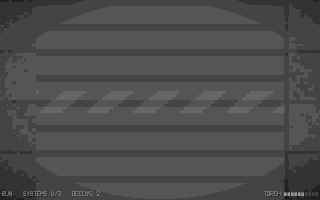
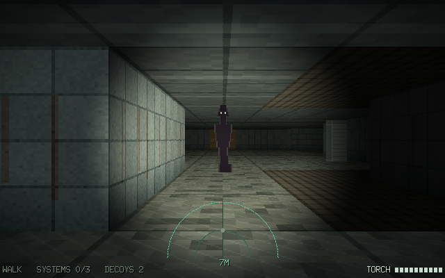

# nemesis

> *nemesis* — retribution that remembers.

[](https://github.com/danielriddell21/nemesis/actions/workflows/ci.yaml)
[](https://codecov.io/gh/danielriddell21/nemesis)
[](https://sonarcloud.io/summary/new_code?id=danielriddell21_nemesis)
[](https://go.dev)
[](LICENSE)

A procedurally generated first-person stealth game written in Go with [Ebiten](https://ebitengine.org/) v2, hunted by an Alien-Isolation-style AI.

Every run drops you into a freshly generated station — rooms and corridors threaded with crawl-height vent ducts — with one other thing aboard. Bring the generator consoles online, then reach the airlock, without being caught by a hunter that hears your footsteps, sees you in the light, stalks you through the vents, and is quietly steered toward you by a director that always knows where you are but never tells it exactly. Clear a station and you descend to the next, deeper deck — against the same hunter, which **remembers what you did**. Levels are deterministic from a seed.

```sh
go run ./cmd/nemesis --seed 42
```



## In the dark

The station's lights are failing. Rooms sit in a weak, flickering glow, corridors are close to black, and some fixtures have blown outright — in those, the only things you will see are the lamp on a spare power cell and two pale points where the hunter's eyes are.

You carry a torch (`R`). It turns the murk into something you can navigate, and it is the most dangerous thing you own:

- **It runs down.** A full cell is about eighty seconds of beam. In its last fifth it dims and stutters; then it dies. Spare cells lie around the deck, each worth half a charge.
- **It gives you away.** Darkness and stillness shorten the hunter's sight; a lit torch cancels both, and it can be seen from much further off. Even with its back turned, a hunter with a line to you inside eight tiles notices the glow and comes to look.
- **So you ration it.** Light to find the console, dark to cross the room the tracker says it is in. Ducking into a locker kills the beam for you.

The hunter listens as well as it looks. Lose it round a corner and keep sprinting, and it follows the footsteps; go quiet and the trail goes cold. Your own pulse is the best warning you have — it quickens as the hunter closes, and its breathing can be placed by ear.



| Key | Action |
| --- | --- |
| `WASD` / mouse | move / look |
| `Shift` / `Ctrl` | run (loud) / sneak (quiet) |
| `E` | open a door, hack a console |
| `R` | torch on / off |
| `T` or right mouse | raise the motion tracker (it pings — the hunter can hear it) |
| `Q` or left mouse | throw a decoy |
| `F` | hide in a locker / leave it |
| `Esc` | pause |

## Install

### Homebrew (macOS)
```sh
brew install --cask danielriddell21/tap/nemesis
```

### From source
On Linux/Windows, build from source:

```sh
go build ./cmd/nemesis
```

<details>
<summary>Linux: OpenGL/X11 libraries</summary>

The window needs OpenGL/X11. On Debian/Ubuntu:

```sh
sudo apt install libgl1-mesa-dev libxrandr-dev libxcursor-dev libxinerama-dev libxi-dev
```
</details>

## Documentation

Full documentation lives in the [nemesis wiki](https://github.com/danielriddell21/nemesis/wiki) — features, controls, CLI flags, how the hunter thinks, and the architecture.
